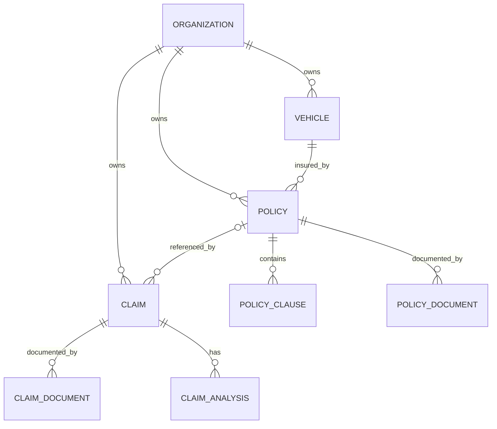

# Insurance domain model

All entities use UUID primary keys. Policies reference a vehicle in the same organization through a composite foreign key. Claims optionally reference a policy in the same organization through another composite foreign key. Organization-scoped policy and claim numbers are unique; provided VINs are unique within an organization. PostgreSQL enforces these boundaries even for writes outside the ORM.

The database also enforces nonnegative monetary amounts, valid policy date ranges, nonblank claim descriptions and clause contents, valid status values, and document parent references. Monetary columns use `NUMERIC`; event timestamps include a time zone. A policy's `active` status alone does not establish coverage on an incident date. Currency codes are checked for uppercase three-letter format only, not against the complete ISO list.

Policy clauses are separate records for later retrieval. Documents store metadata, not file contents. ClaimAnalysis supports multiple results per claim and retains provider and model metadata for the future extraction module in the same application. Failed analyses cannot contain extracted data. This schema does not itself run a model or decide claims.

Fixtures use deterministic IDs and fixed dates. Their wording is illustrative and does not establish actual Egyptian policy terms. Tenant referential integrity is not tenant authorization.
